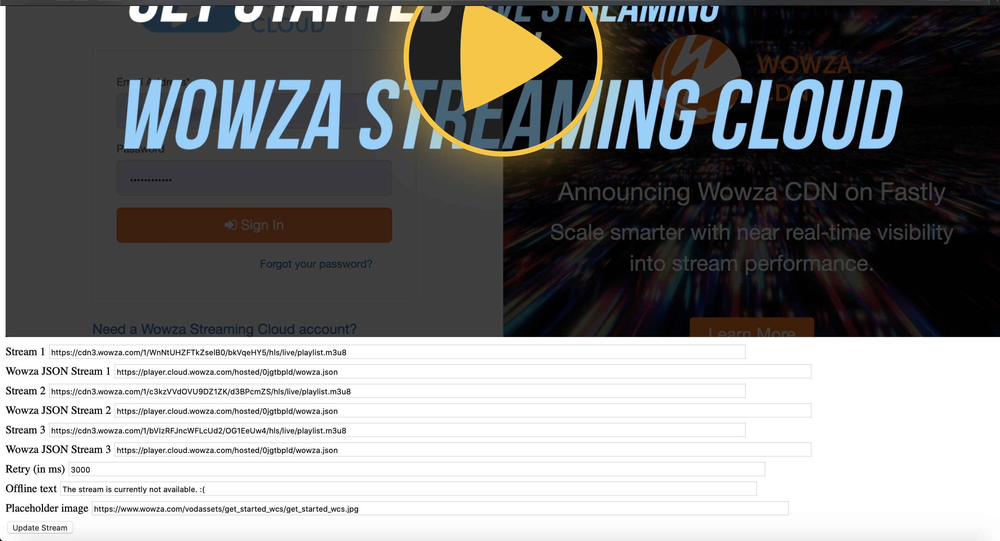
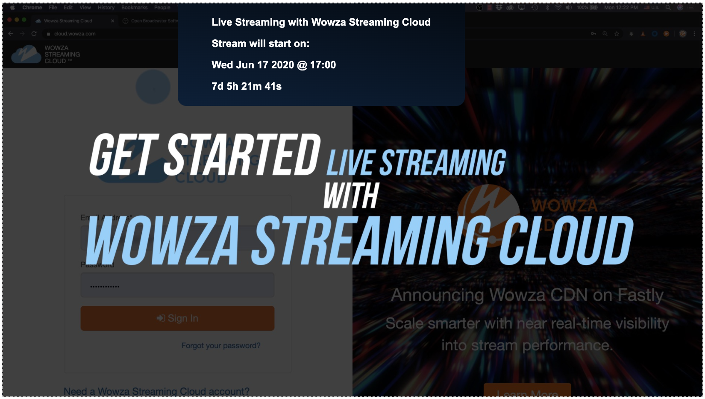
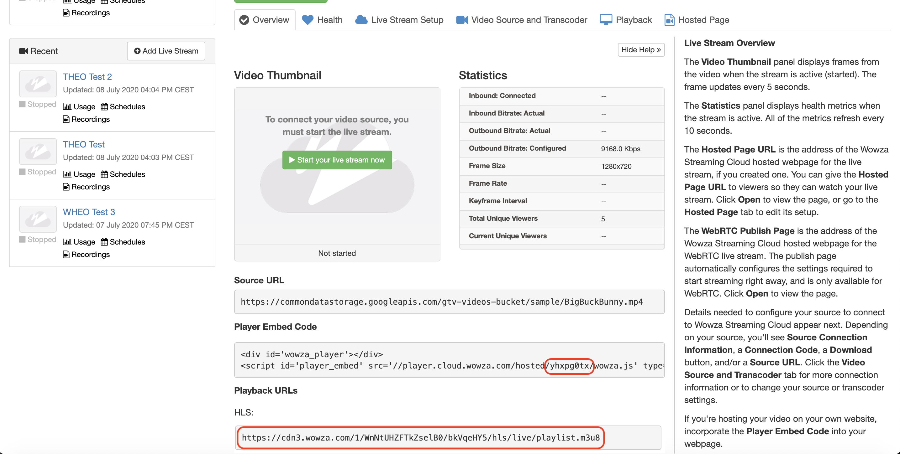

# OptiView Player and Wowza Streaming Cloud
Wowza (Streaming Cloud) and OptiView Player are partners in the streaming industry. When developers use both products,
* [Wowza Streaming Cloud](https://cloud.wowza.com/) is used on the back-end to manage live streams.
* [OptiView Player](https://optiview.dolby.com/docs/theoplayer/) is used on the client-side to playout the live streams.

Cross-product documentation resources:
* https://www.wowza.com/blog/wowza-streaming-cloud-getting-started

This reference app demonstrates an integration between OptiView Player and Wowza Streaming Cloud.
 * You can use this project as a starting template for Wowza and OptiView Player playback.
 * You can leverage the `theoplayer-wowza.js` JavaScript library. **This is completely optional.**
 This JavaScript file exposes an API which automatically unlocks a number of features which bridge OptiView Player and Wowza functionalities.

Head over to https://www.wowza.com/blog/wowza-streaming-cloud-getting-started for an introduction to Wowza Streaming Cloud and OptiView Player.

# Features of `theoplayer-wowza.js`
## Livestream information retrieval
When setting a stream, you can supply a Wowza configuration which will be intercepted and processed by `theoplayer-wowza.js`.
If this configuration contains the `jsonUrl`, then the JSON response will automatically be fetched and exposed.

Furthermore,

* OptiView Player overlays the title when the video is paused.
* OptiView Player sets the poster image if no prior poster has been configured.
* OptiView Player leverages this information to enhance the offline-primary-stream-to-online-primary-stream-to-offline-primary-stream-to-online-backup-stream transitions. (See below.) 

## Enhanced offline-to-online-to-offline-to-online-backupstream transitions
The main use-case of Wowza Streaming Engine is to continuously stream live video.

The Lifecycle of Continuous Play using Wowza Streaming Engine with OptiView Player

    1. Add Several Live Streams (START)
    2. Start Each Live Stream
    3. Stop First Live Stream
    4. Verify Next Available Online Stream Starts Automatically
    5. Stop All Streams
    5. Delete All Live Streams (END)
  
  * When you add your live streams, your streams are offline.
  * Before you start your live streams, all your streams remain offline.
  * When you start all your live streams, your first live stream goes online.
  * When you stop your first live stream, your first live stream goes offline and your first online backup live stream remains online and takes over play.
  * When you stop your first backup live stream, a subsequent backup live stream (if specified) remains online and takes over play.
  * When you re-start your first live stream and stop all other live streams, your first live stream goes online and takes over play.
  * When you stop all your live streams, all your streams go offline.

When you supply a Wowza configuration, the following functionalities are unlocked:

* When all your live streams are offline, OptiView Player displays a placeholder image, which overlaps the video player.
* When your first live stream becomes available, OptiView Player automatically starts playing the stream.
* When your first live stream stops, OptiView Player automatically checks and plays the next available online backup stream.
* When all your backup streams are down but your first live stream is back up, OptiView Player automatically starts playing this stream.



What's shown inside of the placeholder?

* A single, configurable status message.
* A poster image, title and countdown clock -- if the `jsonUrl` is provided.

# Setting up a Wowza live stream

Login to your Wowza account and configure several livestreams.

After configuring your livestreams, you will have access to your HLS live streams and your public stream ID's.



In the screenshot above, `https://cdn3.wowza.com/1/WnNtUHZFTkZselB0/bkVqeHY5/hls/live/playlist.m3u8` is the URL of the first HLS live stream, and `yhxpg0tx` is the respective public stream ID.
You can create your public JSON URL by entering the stream ID in the following template: `https://player.cloud.wowza.com/hosted/<stream ID>/wowza.json`.

To specify your backup stream(s), add a new JSON object, for each backup stream, in the `backupStreams` array of your HTML file.

# Running this sample

1. Install [Node.js](https://nodejs.org/) 22.12 or later.
2. In this folder, install the dependencies, build the app and start the local server:
   ```sh
   npm install
   npm run build
   npm start
   ```
   Use `npm run build-dev` instead of `npm run build` for an unminified build.
3. Open http://localhost:8000.
4. Enter the URL of your own Wowza Streaming Cloud HLS stream and its `wowza.json` URL. The sample has no working default stream, because the Wowza streams it used are no longer available.

This sample is a separate npm project, so the root `npm start` does not build or serve it.

## About the player implementation

* `npm run build` bundles [`src/`](src) into `public/js/theoplayer-wowza.js` with webpack. It also copies the player files from `node_modules/theoplayer` to `public/vendor/theoplayer/`. Both are build output and not committed.
* [`public/index.html`](public/index.html) loads `vendor/theoplayer/THEOplayer.js` and sets `libraryLocation` to `vendor/theoplayer/`.
* Set your stream URLs, Wowza configuration and `license` in the player configuration in `public/index.html`. Without a license, the player only plays on `localhost`, and only streams that the default license allows. Get a license on [THEOportal](https://portal.theoplayer.com).

# Live Demo
A live demo is available at https://cdn.theoplayer.com/demos/wowza/backup-streams-demo/index.html

# API of `theoplayer-wowza.js`

`THEOplayerWowza`: the global variable which exposes a function to register a video player.
```javascript
const wowzaSession = theoplayerWowza.registerPlayer(player);
```
The `wowzaSession` exposes two functions:
```javascript
wowzaSession.getState(); // returns 'offline' or 'online'
wowzaSession.getStreamData(); // returns the jsonUrl response (e.g. {"title":"Live Streaming with Wowza Streaming Cloud","image":"//prod-railsapp.s3.amazonaws.com/uploads/player/video_poster_image/1153020/get_started_wcs.jpg","live":true,"live_done":false,"countdown":true,"countdown_timestamp":"1592413200","file":"https://cdn3.wowza.com/1/ZTdJRm1BaEJSVFh0/MUpKb0Vy/hls/live/playlist.m3u8","sources":[]})
```
You can use a `WowzaConfiguration` when you have registered your player through `theoplayerWowza.registerPlayer(player)`.
```javascript
    var element = document.querySelector('.theoplayer-container');
    var player = new THEOplayer.Player(element, {
        libraryLocation : 'vendor/theoplayer/'
    });

    const wowzaSession = theoplayerWowza.registerPlayer(player);

    function getSourceDescription() {
        //var jsonUrl = document.getElementById('wowzaJson_1').value;
        return {
            sources : [{
                src : document.getElementById('src_1').value,
                type : 'application/x-mpegurl'
            }],
            metadata: {
                wowza: {
                    jsonUrl: document.getElementById('wowzaJson_1').value,
                    retry: document.getElementById('retry').value,
                    offlineText: document.getElementById('offlineText').value,
                    placeholderImageUrl: document.getElementById('placeholderImg').value,
                    queryParametersPassthrough: true,
                    statechangeCallback: console.log,
                    datachangeCallback: console.log,
                    backupStreams: [
                            { sources : [{
                                src : document.getElementById('src_2').value,
                                type : 'application/x-mpegurl'
                                }],
                                metadata: {
                                    wowza: {
                                        jsonUrl: document.getElementById('wowzaJson_2').value,
                                        retry: document.getElementById('retry').value,
                                        offlineText: document.getElementById('offlineText').value,
                                        placeholderImageUrl: document.getElementById('placeholderImg').value,
                                        queryParametersPassthrough: true,
                                        statechangeCallback: console.log,
                                        datachangeCallback: console.log
                                    }
                                }
                            },
                            { sources : [{
                                src : document.getElementById('src_3').value,
                                type : 'application/x-mpegurl'
                                }],
                                metadata: {
                                    wowza: {
                                        jsonUrl: document.getElementById('wowzaJson_3').value,
                                        retry: document.getElementById('retry').value,
                                        offlineText: document.getElementById('offlineText').value,
                                        placeholderImageUrl: document.getElementById('placeholderImg').value,
                                        queryParametersPassthrough: true,
                                        statechangeCallback: console.log,
                                        datachangeCallback: console.log
                                    }
                                }
                            },
                        ]
                    }
                }
        };
    }

    player.source = getSourceDescription();

    document.getElementById('update').addEventListener('click', function() {
        player.source = getSourceDescription();
    })
```

In a `WowzaSourceConfiguration`, you can configure the following flags:

- `jsonUrl`: the JSON URL which returns the Wowza stream information.
- `retry`: the amount of milliseconds which the client should wait to check if the stream is back online.
- `offlineText`: the text which should be shown if the stream is unavailable, and if there's no `jsonUrl`.
- `placeholderImageUrl`: the image which should be shown in the background when there is no `jsonUrl`.
- `queryParametersPassthrough`: setting this value to true appends the query parameters of your HLS master playlist to all other requests (e.g. media playlists, segments, ...).

This feature can be useful when doing [token authentication](https://www.wowza.com/docs/security-features-in-wowza-streaming-cloud#security-features-for-hls-streams-using-wowza-cdn-on-fastly).

- `datachangeCallback`: the function which should be called when the response from `jsonUrl` is available.
- `statechangeCallback`: the function which should be called when a stream either becomes available or unavailable.
- `backupStreams`: an array of your backup live streams, each containing their respective stream source and flag configurations as listed in the main `WowzaSourceConfiguration`.

# Resources

* [Getting started with OptiView Player on Web](https://optiview.dolby.com/docs/theoplayer/getting-started/sdks/web/getting-started/)
* [OptiView Player examples](https://optiview.dolby.com/docs/theoplayer/examples/)
