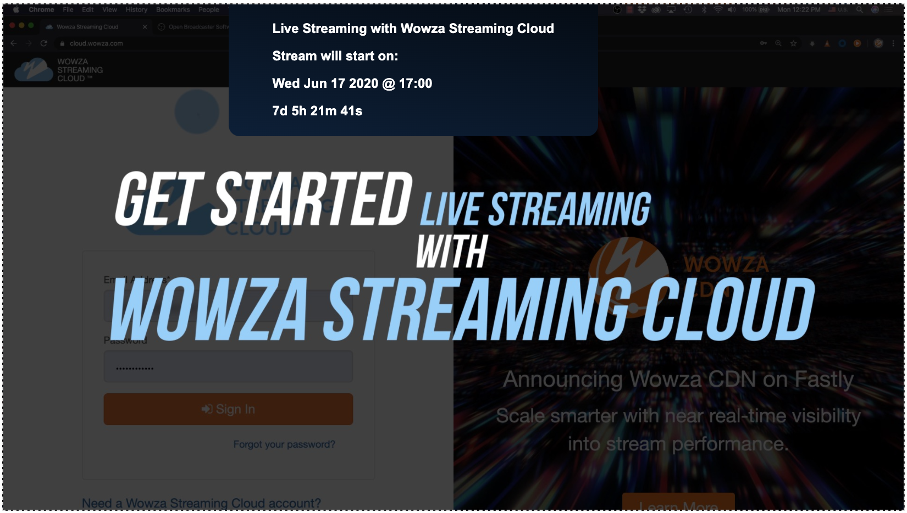
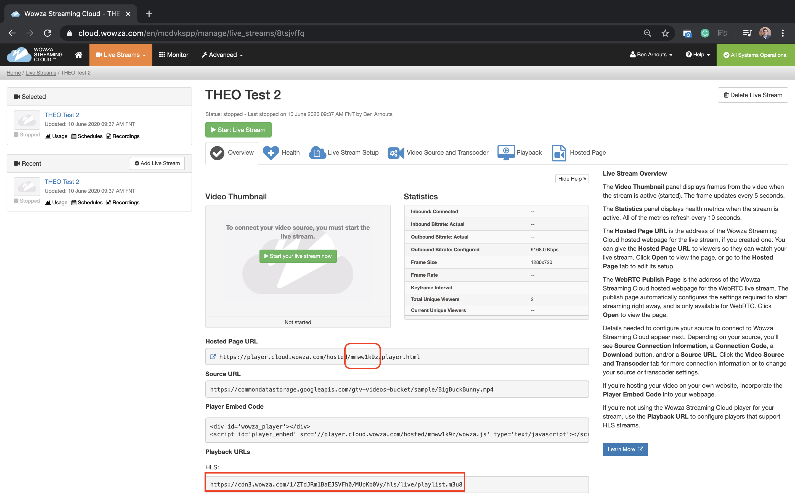

# OptiView Player and Wowza Streaming Cloud
Wowza and OptiView Player are partners in the streaming industry. When developers use both products,
* Wowza Streaming Cloud is used on the back-end to manage live streams.
* OptiView Player is used on the client-side to playout the live streams.

Cross-product documentation resources:
* https://www.wowza.com/blog/wowza-streaming-cloud-getting-started

This reference app demonstrates an integration between OptiView Player and Wowza Streaming Cloud.
 * You can use this project as a starting template for Wowza and OptiView Player playback.
 * You can leverage the `theoplayer-wowza.js` JavaScript library. **This is completely optional.**
 This JavaScript file exposes an API which automatically unlocks a number of features which bridge OptiView Player and Wowza functionalities.

Head over to https://www.wowza.com/blog/wowza-streaming-cloud-getting-started for an introduction to Wowza Streaming Cloud and OptiView Player.

# Features of `theoplayer-wowza.js`
## Livestream information retrieval
When setting a stream, you can supply a Wowza configuration which will be intercepted and processed by `theoplayer-wowza.js`.
If this configuration contains the `jsonUrl`, then the JSON response will automatically be fetched and exposed.
Furthermore,
* OptiView Player overlays the title when the video is paused.
* OptiView Player sets the poster image if no prior poster has been configured.
* OptiView Player leverages this information to enhance the offline-to-online-to-offline transitions. (See below.) 

## Enhanced offline-to-online-to-offline transitions
The main use-case of Wowza Streaming Cloud is to stream live video.

<details>
  <summary>The lifecycle of Wowza Streaming Cloud</summary>
  
  1. Add Live Stream (START)
     2. Start Live Stream
        3. Stop Live Stream
           5. Start Live Stream (go back to 1.i.)
           6. Delete Live Stream (END)
        4. Reset Live Stream
           7. Stop Live Stream (go back to 1.i.a.) 
           8. Reset Live Stream (go back to 1.i.b.)
           
  In this lifecycle, the following statements are true:
  * When you add your live stream, your stream is offline.
  * Before you start your live stream, your stream remains offline.
  * When you start your live stream, your stream goes online.
  * When you stop your live stream, your stream goes offline.
  * When you (re)start your livestream, your stream goes online.
</details>

When you supply a Wowza configuration, the following functionalities are unlocked:
* When your live stream is still offline, then OptiView Player displays a placeholder which overlaps the video player.
* When your live stream becomes available, then OptiView Player automatically starts playing the stream.
* When your live stream stops, then OptiView Player displays a placeholder which overlaps the video player.
* When your live stream restarts, then OptiView Player automatically starts playing the stream.




What's shown inside of the placeholder?
* A) A single, configurable status message.
* B) A poster image, title and countdown clock -- if the `jsonUrl` is provided.

# Setting up a Wowza live stream

Login to your Wowza account and configure a livestream.

After configuring your livestream, you'll have access to your HLS live stream and your public stream ID.




In the screenshot above, `https://cdn3.wowza.com/1/ZTdJRm1BaEJSVFh0/MUpKb0Vy/hls/live/playlist.m3u8
` is the URL of the HLS live stream, and `mmww1k9z` is your public stream ID.
You can create your public JSON URL by entering the stream ID in the following template: `https://player.cloud.wowza.com/hosted/<stream ID>/wowza.json`.

# Running this sample

1. Install [Node.js](https://nodejs.org/) 22.12 or later.
2. In this folder, install the dependencies, build the app and start the local server:
   ```sh
   npm install
   npm run build
   npm start
   ```
   Use `npm run build-dev` instead of `npm run build` for an unminified build.
3. Open http://localhost:8000.
4. Enter the URL of your own Wowza Streaming Cloud HLS stream and its `wowza.json` URL. The sample has no working default stream, because the Wowza streams it used are no longer available.

This sample is a separate npm project, so the root `npm start` does not build or serve it.

## About the player implementation

* `npm run build` bundles [`src/`](src) into `public/js/theoplayer-wowza.js` with webpack. It also copies the player files from `node_modules/theoplayer` to `public/vendor/theoplayer/`. Both are build output and not committed.
* [`public/index.html`](public/index.html) loads `vendor/theoplayer/THEOplayer.js` and sets `libraryLocation` to `vendor/theoplayer/`.
* Set your stream URLs, Wowza configuration and `license` in the player configuration in `public/index.html`. Without a license, the player only plays on `localhost`, and only streams that the default license allows. Get a license on [THEOportal](https://portal.theoplayer.com).

# Live Demo
A live demo is available at https://cdn.theoplayer.com/demos/wowza/github-reference-app/index.html.

# API of `theoplayer-wowza.js`

`THEOplayerWowza`: the global variable which exposes a function to register a video player.
```javascript
const wowzaSession = theoplayerWowza.registerPlayer(player);
```
The `wowzaSession` exposes two functions:
```javascript
wowzaSession.getState(); // returns 'offline' or 'online'
wowzaSession.getStreamData(); // returns the jsonUrl response (e.g. {"title":"Live Streaming with Wowza Streaming Cloud","image":"//prod-railsapp.s3.amazonaws.com/uploads/player/video_poster_image/1153020/get_started_wcs.jpg","live":true,"live_done":false,"countdown":true,"countdown_timestamp":"1592413200","file":"https://cdn3.wowza.com/1/ZTdJRm1BaEJSVFh0/MUpKb0Vy/hls/live/playlist.m3u8","sources":[]})
```
You can use a `WowzaConfiguration` when you have registered your player through `theoplayerWowza.registerPlayer(player)`.
```javascript
const wowzaConfiguration = {
    "jsonUrl": "https://player.cloud.wowza.com/hosted/mmww1k9z/wowza.json",
    "retry": "3000",
    "offlineText": "The stream is currently not available. :(",
    "placeholderImageUrl": "https://www.wowza.com/vodassets/get_started_wcs/get_started_wcs.jpg",
    "datachangeCallback": console.log,
    "statechangeCallback": console.log        
};

player.source = {
    "sources": [
        {
          "src": "https://cdn3.wowza.com/1/ZTdJRm1BaEJSVFh0/MUpKb0Vy/hls/live/playlist.m3u8",
          "type": "application/x-mpegurl"
        }
    ],
    "metadata": {
        "wowza": wowzaConfiguration
    }
}
```

In a `WowzaSourceConfiguration`, you can configure the following flags:
- `jsonUrl`: the JSON URL which returns the Wowza stream information.
- `retry`: the amount of milliseconds which the client should wait to check if the stream is back online.
- `offlineText`: the text which should be shown if the stream is unavailable, and if there's no `jsonUrl`.
- `placeholderImageUrl`: the image which should be shown in the background when there is no `jsonUrl`.
- `datachangeCallback`: the function which should be called when the response from `jsonUrl` is available.
- `statechangeCallback`: the function which should be called when a stream either becomes available or unavailable.


# Resources

* [Getting started with OptiView Player on Web](https://optiview.dolby.com/docs/theoplayer/getting-started/sdks/web/getting-started/)
* [OptiView Player examples](https://optiview.dolby.com/docs/theoplayer/examples/)
